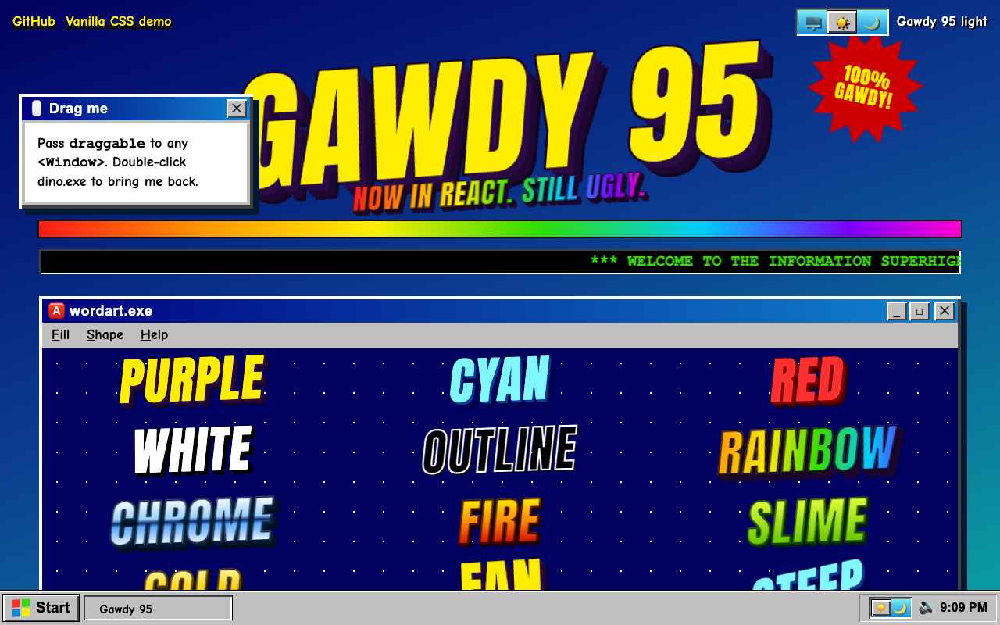
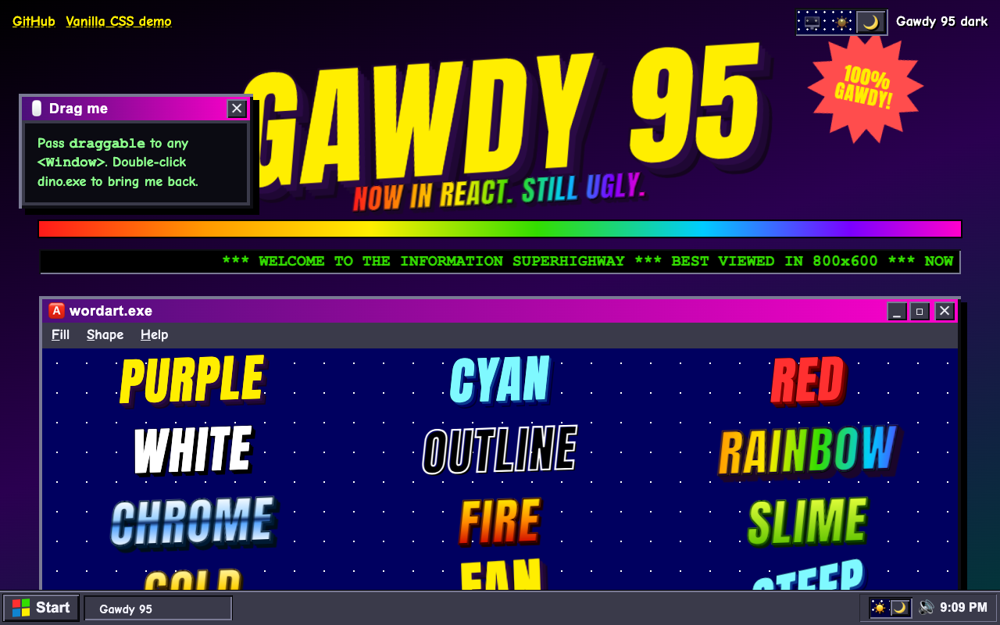
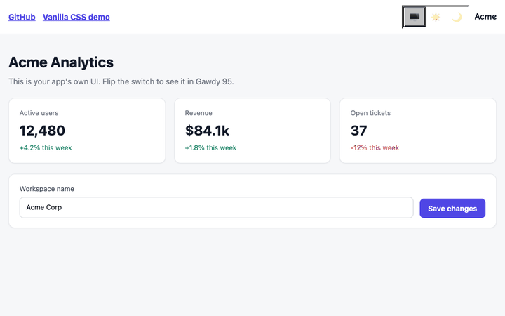
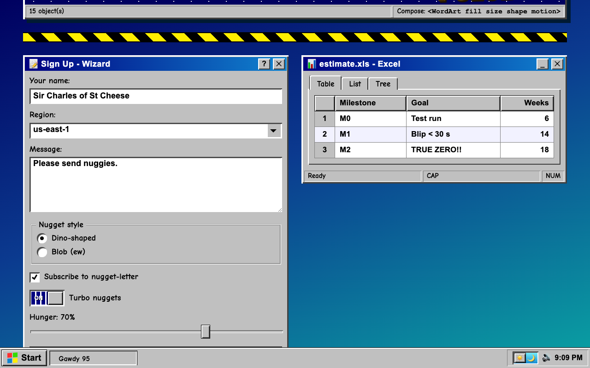
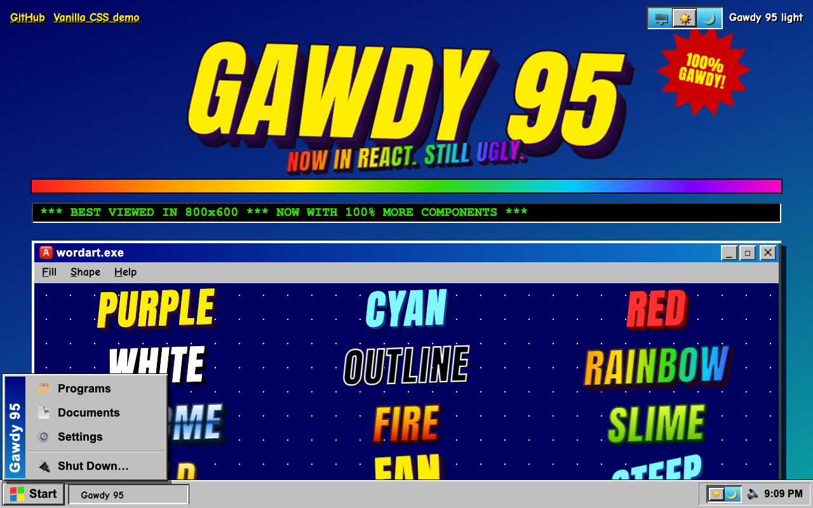
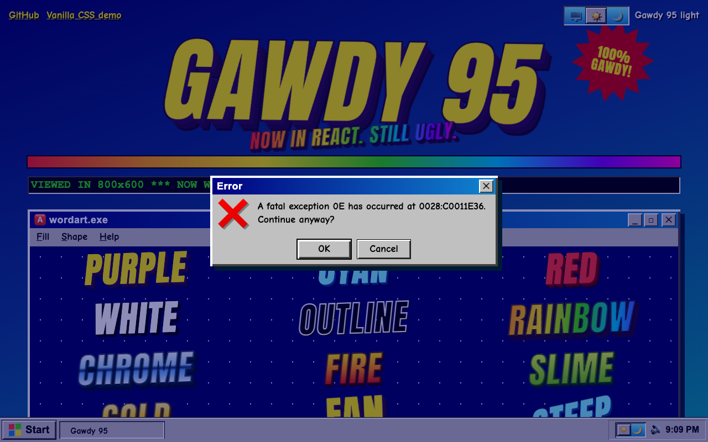
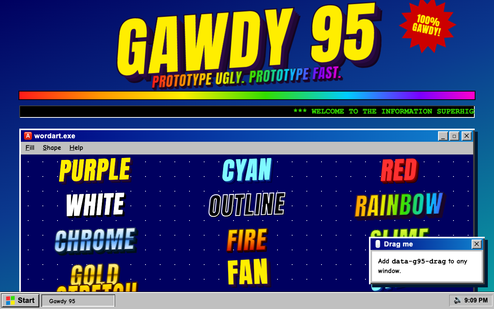

# Gawdy95

A Windows 95 + WordArt CSS framework for quickly prototyping deliberately gaudy web interfaces. No build step, no dependencies. Add one stylesheet, optionally one script, and start adding classes.

The style: chunky grey bevels, navy-to-cyan title bars, rainbow gradients, and extruded, stroked WordArt text.

**[▶ Live demo](https://treybae.github.io/gawdy95/)** (React components) · **[Vanilla CSS demo](https://treybae.github.io/gawdy95/vanilla/)** (the original kitchen sink)



## Preview

A dark theme too: add `g95-dark`, or use the switches in the React package.



**Flip a whole app between your own UI, Gawdy95 light and Gawdy95 dark** with one switch (`GawdyUiSwitch`):



| Windows, forms, tabs and tables | Start menu | Dialogs |
| --- | --- | --- |
|  |  |  |

No build step needed for the plain CSS version either:



## Files

- `gawdy95.css`: tokens, bevels, components, WordArt, layout and utilities
- `gawdy95.js`: optional behaviour (window drag/min/max/close, Start menu, modals, tabs, clock, hit counter)

## Quick start

```html
<!doctype html>
<html lang="en">
<head>
  <meta charset="utf-8">
  <meta name="viewport" content="width=device-width, initial-scale=1">
  <title>My Ugly App</title>
  <link rel="stylesheet" href="gawdy95.css">
  <script src="gawdy95.js" defer></script>
</head>
<body class="g95">
  <h1 class="wa wa-purple wa-xl">Hello</h1>

  <div class="g95-window g95-pop">
    <div class="g95-titlebar">
      <span class="g95-titlebar__text">hello.exe</span>
      <span class="g95-titlebar__btns"><button class="g95-close" data-g95-act="close">✕</button></span>
    </div>
    <div class="g95-window__body">
      <button class="g95-btn g95-btn--default">OK</button>
    </div>
  </div>
</body>
</html>
```

`<body class="g95">` is required. It sets the desktop background, base font and the scoped reset.

Fonts (Anton and Comic Neue) load from Google Fonts via `@import` at the top of the CSS. Offline, text falls back to Impact and Trebuchet MS.

## Naming

- `g95-*`: components and layout (`g95-window`, `g95-btn`, `g95-grid`)
- `g95-*__*`: component parts (`g95-titlebar__text`)
- `g95-*--*`: variants (`g95-btn--danger`)
- `wa`, `wa-*`: WordArt
- `g95-u-*`: single-purpose utilities
- `is-*`: state classes (`is-pressed`, `is-selected`, `is-inactive`)

## Components

### Windows

`g95-window` (add `g95-pop` for the hard offset shadow) containing `g95-titlebar`, optional `g95-menubar`, `g95-window__body`, and optional `g95-statusbar`. Add `g95-notepad` to the body for a white text-editor surface.

### Buttons

`g95-btn`, with modifiers `--default`, `--big`, `--block`, `--ok`, `--danger`, `--rainbow`, `--flat`. Add `is-pressed` for a held-down state. Group buttons with `g95-btn-row`.

### Form controls

- `g95-input`, `g95-textarea`
- `g95-select` (wrap in `g95-selectwrap` to get the arrow)
- `g95-check`, `g95-radio` (a `label` wrapping the native `input`)
- `g95-range`
- `g95-progress` (`--rainbow`, `--anim`; markup is `<div class="g95-progress" style="--p:60%"><i></i></div>`)
- `g95-groove` (a fieldset with a `legend`)
- `g95-form` for stacked fields, `g95-form--inline` with `g95-field-row` for label/field rows

### Data display

- `g95-table`: `g95-table--sheet` for a spreadsheet look, `is-num` on cells to right-align
- `g95-list`: selectable list box
- `g95-tree`: nested `ul` with folder and file icons (`is-file` on leaf items)
- `g95-tabs` with `role="tab"` buttons, plus `g95-tabpanel`

### Desktop shell

`g95-desktop`, `g95-icons` containing `g95-icon` items, and `g95-taskbar` containing `g95-start` (with a `g95-menu`), `g95-tasks` and `g95-tray`. The taskbar is fixed to the bottom of the viewport, and `body.g95` reserves space for it.

### Dialogs

`g95-modal` (full-screen overlay) wrapping a `g95-window g95-dialog`. Inside, use `g95-dialog__row`, `g95-dialog__glyph` and `g95-dialog__actions`.

### Gaudy extras

- `g95-starburst` (`--red`, `--lime`, `--lg`), `g95-corner` to pin it to a corner
- `g95-badge` (blinking), `g95-blink`
- `g95-stamp` (`--ok`)
- `g95-note` (`--green`, `--pink`)
- `g95-alert` (`--ok`, `--warn`)
- `g95-tape`, `g95-construction`
- `g95-marquee`, `g95-counter`, `g95-led` (`--red`, `--off`)
- `g95-banner`, `g95-rainbow-bar` (`--thick`), `g95-rainbow-text`
- Backgrounds: `g95-bg-stars`, `g95-bg-tile`, `g95-bg-teal`, `g95-bg-bliss`, `g95-bg-note`, `g95-bg-paper`, `g95-dither`

### Layout and utilities

Layout: `g95-wrap`, `g95-stack`, `g95-row`, `g95-grid` (`--3`, `--4`, or set `--cols`), `g95-auto`, `g95-split`. Control spacing with the `--g` custom property, for example `style="--g:28px"`.

Utilities: `g95-u-center`, `-right`, `-white`, `-yellow`, `-red`, `-green`, `-navy`, `-shadow`, `-shadow-lg`, `-serif`, `-sys`, `-mono`, `-display`, `-sm`, `-lg`, `-xl`, `-rot-l`, `-rot-r`, `-rot-l2`, `-rot-r2`, `-m0`, `-mt`, `-mb`, `-p`, `-w100`, `-rel`, `-hide`.

## WordArt

Compose three parts: `class="wa wa-FILL wa-SIZE wa-SHAPE"`.

| Part | Options |
| --- | --- |
| Fill | `wa-purple`, `wa-cyan`, `wa-red`, `wa-white`, `wa-outline`, `wa-rainbow`, `wa-chrome`, `wa-fire`, `wa-slime`, `wa-gold` |
| Size | `wa-sm`, `wa-md`, `wa-lg`, `wa-xl` (fluid, using `clamp()`) |
| Shape | `wa-flat`, `wa-tilt`, `wa-tilt-r`, `wa-steep`, `wa-fan`, `wa-fan-r`, `wa-stretch`, `wa-squish`, `wa-arc` |
| Motion | `wa-wobble`, `wa-pulse`, `wa-spin`, `wa-hue` |

```html
<h1 class="wa wa-rainbow wa-lg wa-tilt wa-wobble">Under Construction</h1>
```

Extrusion depth is set in `em`, so it scales with font size. The gradient fills (`rainbow`, `chrome`, `fire`, `slime`, `gold`) use `filter: drop-shadow()` instead of `text-shadow`, because `text-shadow` paints over transparent, clipped text. An element has only one `filter`, so `wa-hue` replaces the drop-shadow on those fills.

## JavaScript behaviour

`gawdy95.js` is optional. All behaviour is wired through data attributes, and no initialisation call is needed.

| Attribute | On | Effect |
| --- | --- | --- |
| `data-g95-drag` | `.g95-window` | Drag by the title bar. Give the window `position: fixed` or `absolute` and offsets. |
| `data-g95-act="min"`, `"max"`, `"close"` | title bar button | Minimise, maximise or close the window |
| `data-g95-toggle="#id"` | any element | Toggle `hidden` on the target (for example the Start menu) |
| `data-g95-open="#id"` | any element | Show the target (for example a modal) |
| `data-g95-close` or `data-g95-close="#id"` | any element | Hide the target, or the nearest `.g95-modal` when no value is given |
| `[role="tab"][aria-controls]` inside `.g95-tabs` | tab buttons | Switch tab panels |
| `data-g95-clock` | any element | Live `HH:MM` clock |
| `data-g95-count="001337"` | any element | Renders hit-counter digits |

Other behaviour: clicking a `.g95-list` item selects it, Escape closes open modals, and clicking outside the Start menu closes it.

## Theming

Everything is driven by custom properties on `:root` in `gawdy95.css`:

- Colours: `--g95-face`, `--g95-navy`, `--g95-sky`, `--g95-yellow`, `--g95-danger`, and others
- Fonts: `--g95-font`, `--g95-font-sys`, `--g95-font-mono`, `--g95-font-display`
- Gradients: `--g95-rainbow`, `--g95-titlebar`, `--g95-desktop`
- Bevel width: `--g95-bw`. Add `g95-chunky` to any element for 4px bevels.

## Browser support

Built for current Chromium, Firefox and Safari. It uses `clip-path`, `background-clip: text`, `-webkit-text-stroke`, `paint-order`, and the individual `scale` and `rotate` properties in animations. Scrollbar styling uses `::-webkit-scrollbar`, so it applies in Chromium and Safari only. Animations respect `prefers-reduced-motion`.

## React

A typed React component library built on these styles lives in [`react/`](react/README.md). It renders the same `g95-*` and `wa-*` classes and reimplements `gawdy95.js` behaviour as React state.

### Updating the live demo

The demo is a static site on the `gh-pages` branch. To rebuild and publish it:

```sh
cd react
pnpm install
./scripts/deploy-pages.sh   # builds site-dist/ and pushes it to gh-pages
```
